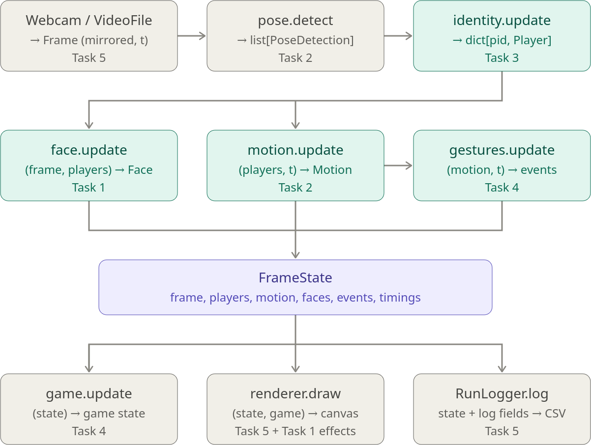

Sep 28, 2026 · @el created with help of Claude Opus 5.5

# Phase 1 status: what exists, what each of us does next

The phase-1 skeleton from the [setup guide](setup-guide.md) now runs end to end on the webcam and on recorded clips. Task 5 code (`core/`, `io/`, `scene/`, `app/`, `tools/`) is complete for phase 1. Every other module started as a **stub** that follows the contracts, so each owner can replace their stub without waiting for anyone. The Colour Clash merge has replaced the stubs of Tasks 1, 3 and 4 and the smoothing of Task 2 with the teammates' code (see the table and [merge_log.md](../merge_log.md)).

This document covers what the pipeline looks like right now, what your stub does and what you need to deliver, and the open items the team still has to fill in.

## Where we are

| Area | Owner | State | Notes |
| --- | --- | --- | --- |
| `core/` contracts, skeleton, filters, timing, config | Task 5 | Done | `types.py` is exactly the agreed contract |
| `io/source.py` webcam + video file | Task 5 | Done | Mirrored at capture; clips replay real timestamps |
| `io/recorder.py` clips + CSV logs | Task 5 | Done | One CSV per run in `logs/` |
| `scene/` renderer (OpenCV) | Task 5 | Done (merged 2026-10-27) | Colour Clash game view from `renderer.py`: pixel look, sprites, paint on the torso, health bars pinned to the bottom, top bar, end panel; name tag, crown and dizzy stars above the head (2026-10-28) |
| `app/pipeline.py`, `app/main.py`, `tools/` | Task 5 | Done | `--until <stage>` for per-module debugging |
| `pose/estimator.py` | Task 2 | Stub (real model) | YOLO26s-pose (small; nano until 2026-10-28), ~10 ms/frame on the RTX 3070 Ti |
| `pose/motion.py` | Task 2 | Smoothing done (merged 2026-10-25) | Confidence gate, hold, EMA, snap back; no signals yet |
| `identity/tracker.py` | Task 3 | Done (merged 2026-10-27) | BoT-SORT on the pose boxes + OSNet re-identification; occluded/lost/re-entry |
| `face/tracker.py`, `face/effects.py` | Task 1 | Done (merged 2026-10-25) | YuNet on per-player head crops, One Euro, optical-flow fallback; hat and mustache; team colour, hit reaction and cheek bulge (2026-10-28) |
| `interaction/gestures.py` | Task 4 | Done (merged 2026-10-25) | Punch, hands up, arms crossed as events |
| `interaction/game.py` | Task 4 | Done (merged 2026-10-26) | Colour Clash game logic from `game.py`: bolts, beams, blocking shields, paint, winner; drawn by `scene/renderer.py` |

Tests: 298 passing (`pytest`), lint clean (`ruff check src tests tools`).

## Architecture as built

### One frame through the pipeline



All of this lives in `Pipeline.step()` in `src/ipcvgame/app/pipeline.py`. It runs on one thread, in this fixed order, and each stage is timed by the profiler.

### Conventions the code already enforces

- **Mirroring happens once, in the source.** Every coordinate you receive is a pixel in the mirrored full-resolution frame. Clips are stored *raw* and mirrored on load, the same as the webcam.
- **Time comes from `Frame.t` in seconds.** For a live webcam that is `perf_counter()` at capture. For clips it is replayed from the `<clip>.timestamps.csv` sidecar, so your filters see the same dt as they did live. Never use frame counts as time.
- **Keypoints are in canonical COCO-17 order.** Index them by name (`from ipcvgame.core import skeleton as sk; kpts[sk.L_WRIST]`). YOLO outputs COCO-17 directly; `skeleton.FROM_MEDIAPIPE33` maps MediaPipe's 33 points if Task 2 switches models.
- **Re-entry resets.** When `Player.reentered` is True, `MotionFilter` clears that player's state itself, and the pipeline calls `face.reset(pid)` and `gestures.reset(pid)`. Keep this behaviour when you replace a stub.
- **Model warm-up.** The pipeline runs one dummy frame through the model at startup, so the ~3 s CUDA initialisation never shows up as a gap between frames 0 and 1.

### The module interface

Every module has the same methods; replace the body, keep the signature.

| Method | Purpose |
| --- | --- |
| `__init__(cfg)` | Receives *its own* section of `configs/default.yaml` |
| `update(...)` | Typed inputs → its own output type (pose uses `detect(frame)`) |
| `reset(pid=None)` | Clear state for one player, or all when `pid` is None |
| `draw_debug(canvas, state)` | Draw your internals; shown with `--until <your stage>` |
| `log_fields(state) -> dict` *(optional)* | Extra CSV columns, named `<stage>_p<pid>_<field>`, e.g. `face_p1_roll` |

`log_fields` is new since the setup guide. It is optional and does not touch `types.py`.

### Shared code you should use rather than rewrite

- `core/filters.py`: `OneEuro`, `EMA` and `ConstantVelocityKalman`. They work on any array shape (e.g. `(17, 2)` keypoints) and take the real `t`. `EMA` can let chosen rows jump instead of being smoothed (`snap` mask). They are tested, including a test that the result does not depend on the FPS.
- `core/geometry.py`: `bbox_iou`, `bbox_center`, `clip_bbox`, `crop` (returns the crop plus the offset back to full-frame pixels), `angle_at` (angle at a joint, in degrees).
- `scene/draw.py`: `player_color(pid)`, `draw_skeleton`, `draw_bbox`, `draw_text`, so debug views use the same colours everywhere.

### Config

`configs/default.yaml` has one section per module: `source`, `pose`, `identity`, `motion`, `face`, `gestures`, `game`, `recorder`, `render`. Every threshold goes in your section with a comment explaining its value. You can override any value from the command line without editing the file: `--set identity.max_players=2`.

There are no cross-section reads: since the Colour Clash merge, `FaceTracker` reads its own `face.kpt_conf_threshold` instead of `motion.kpt_conf_threshold`.

### Naming conventions

**Tasks vs stages.** Task numbers are for people and branches only. The code never uses them; it uses **stage names**, one per pipeline step, and the same name appears everywhere that step shows up:

| Stage | Task | Code | Config section | `--until` | CSV timing column |
| --- | --- | --- | --- | --- | --- |
| `pose` | 2 | `pose/estimator.py` | `pose:` | `pose` | `ms_pose` |
| `identity` | 3 | `identity/tracker.py` | `identity:` | `identity` | `ms_identity` |
| `motion` | 2 | `pose/motion.py` | `motion:` | `motion` | `ms_motion` |
| `face` | 1 | `face/tracker.py` (+ `effects.py`) | `face:` | `face` | `ms_face` |
| `gestures` | 4 | `interaction/gestures.py` | `gestures:` | `gestures` | `ms_gestures` |
| `game` | 4 | `interaction/game.py` | `game:` | `game` | `ms_game` |
| `render` | 5 | `scene/renderer.py` | `render:` | (default view) | `ms_render` |

`source:` and `recorder:` are Task 5 config sections that are not pipeline stages. `ms_total` is the whole frame. Task 2 and Task 4 each own two stages, which is why a task number cannot name a stage.

**Players.** The player id (`pid`) is the only player identity; every per-player output is keyed by it.

| Where | Form | Example |
| --- | --- | --- |
| Code: `Player.pid`, dict keys, `Face.pid`, `GestureEvent.pid` | int from **1** (never 0) | `state.players[1]`, `state.motion[2]` |
| Screen | `P<pid>` | `P1`, `P2` |
| Colour | `player_color(pid)` | P1 red, P2 blue (the Colour Clash team colours); grey = no pid yet |
| CSV, built-in columns | `p<pid>_<field>` | `p1_status`, `p2_cx` |
| CSV, your `log_fields` | `<stage>_p<pid>_<field>` | `face_p1_roll`, `identity_p2_hist_dist` |

A player keeps their pid for the whole run: when they leave they stay in `players` with `status="lost"`, and they return under the same pid with `reentered=True`.

**Keypoints.** In code use the constants from `core/skeleton.py` (`sk.L_WRIST`); in strings (signals, CSV columns) use the lowercase names from `sk.NAMES` (`l_wrist`).

> ⚠️ **Left/right is the model's label, not the player's side.** Checked with YOLO26n-pose: models label sides as in an ordinary photo, but our frames are mirrored. So `sk.L_WRIST` is the player's own **right** wrist. Keep this in mind for any "raise your left hand" gesture. Whether the adapter should swap the labels is on the decision list below.

**Strings shared between modules** are lowercase `snake_case`:

| What | Rule | Examples | Agreed by |
| --- | --- | --- | --- |
| Player status | fixed set | `active`, `occluded`, `lost` | contract |
| Face anchors | body location | `above_head`, `forehead`, `mouth` | Task 1 ↔ 4, 5 |
| Motion signals | `<side>_<joint>_<quantity>`, or a state name as 0.0/1.0 | `r_wrist_speed`, `hands_above_head` | Task 2 ↔ 4 (proposal) |
| Gesture events | the action | `punch`, `hands_up`, `arms_crossed` | Task 4 (merged) |

**Files and branches.**

| What | Pattern | Examples |
| --- | --- | --- |
| Branch | `task<N>-<name>` | `task1-face`, `task2-pose`, `task3-identity`, `task4-interaction`, `task5-integration` |
| Test clip | `data/clips/<scenario>.mp4` + `<scenario>.timestamps.csv` | `crossing.mp4`, `fast_arms.mp4` |
| Run log | `logs/run-<YYYYMMDD-HHMMSS>.csv` (automatic) | `run-20260928-182420.csv` |
| Evaluation script | `tools/eval_<stage>.py` | `eval_identity.py`, `eval_face.py` |
| Tests | `tests/test_<module>.py` | `test_filters.py`, `test_identity.py` |

### Measured performance (demo candidate: RTX 3070 Ti)

| Stage | ms/frame |
| --- | --- |
| pose (YOLO26s-pose, fp16) | ~10 |
| face (YuNet on head crops + MediaPipe for one player per frame) | ~10.5 on a small clip, ~19 on a 4K clip; MediaPipe is ~8 of that |
| motion (EMA smoothing), gestures (rules) | ~0.1 each |
| identity (BoT-SORT + OSNet, one crop every few frames) | ~0.5 median, ~3 mean, ~13 on frames with an OSNet run |
| game | < 0.1 |
| render (pixel look, sprites, HUD) | ~4.5 at 720p; ~14 on a 4K clip |
| **total** | **~11** |

The pipeline itself could run at ~90 FPS. In the first live test, the webcam delivered only ~15 fps (68 ms between frames), which is likely auto-exposure in dim light. This needs checking before we record the shared clips (see Task 5 below).

## How to work on your module

```bash
conda activate ipcvgame                       # setup: see README.md
python tools/run_module.py --until identity --source data/clips/crossing.mp4
python -m ipcvgame.app.main                   # full game view on the webcam
pytest                                        # before every PR
```

1. Branch from `main` (`task1-face`, `task2-pose`, …). Only edit your own package and your config section.
2. Replace the stub body; keep class names, method signatures and output types.
3. Add unit tests for your module under `tests/` (`tests/test_pipeline.py` shows how to feed fake detections without a model).
4. Add `log_fields` for anything you will want to plot in the report.
5. Write `tools/eval_<task>.py` that runs on the shared clips and prints your metric.
6. Open a PR; Task 5 reviews. Changes to `core/types.py` need a heads-up to everyone first.

## What each person has to do

### Task 1: Face tracking and AR — owner: @eline

**Status (merged 2026-10-25 from the Task 1 owner's YuNet script; details in [merge_log.md](../merge_log.md#task-1-face-tracking-and-ar)):** `FaceTracker` runs OpenCV's YuNet face detector on a head crop per player, taken from that player's pose keypoints, so faces cannot swap between players. A One Euro filter smooths the face key points. When YuNet misses a face, optical flow carries it for up to 1.3 s; after that the effect holds and fades out (`Face.alpha`). `FaceEffects` draws a hat and a mustache, rotated by the head roll and scaled to the face width. `face.backend: stub` brings back the old nose-anchor stand-in.

- [x] Real face model on per-player head crops (YuNet instead of MediaPipe: fast on small crops, finds small faces).
- [x] `Face` fields `landmarks` (5 YuNet points), `center`, `scale`, `roll`, `yaw` (head pose), `valid`, plus the new `alpha`.
- [x] Anchors `above_head`, `forehead`, `mouth`, plus `hat`.
- [x] Smoothing of the 4 face key points with `core/filters.py`; `reset(pid)` clears it.
- [x] Sprite effects in `FaceEffects.draw` (alpha blending, rotation by roll, scaling by face width).
- [x] Thresholds in `face:`; `log_fields` (`face_p<pid>_source`, `_roll_deg`, …); `tools/eval_face.py` (see [evaluation.md](../evaluation.md)).
- [x] Large head crops are shrunk before detection (`crop_max_px`).
- [x] Head pose with `solvePnP` (5 YuNet landmarks, canonical 3D head): fills `Face.yaw`; forehead, hat and `above_head` are 3D points on the head, so they follow tilt and turn.
- [x] MediaPipe Face Landmarker on the face, one player per frame in turn: head rotation for the 3D anchors (reliable also for strong up/down tilt) and blendshape scores in the new `Face.blendshapes` (`jawOpen`, `eyeBlinkLeft`/`Right`, `mouthSmileLeft`/`Right`, …).
- [x] Face effects (`docs/merge_log.md`, "Face effects", 2026-10-28): cheek anchors; the hat band and war paint in the team colour; on a hit, the hat flies off and the face flashes; a cheek bulge (`cv2.remap` warp) that the consumables will start when a player eats. The name tag, crown and dizzy stars above the head are drawn by the renderer.
- [ ] Webcam check of the face effects (`docs/extra_features.md`, follow-ups).
- [ ] Next: game features on top of the face stage, see `docs/extra_features.md`.

### Task 2: Pose and motion — owner: ____________

**Status (smoothing merged 2026-10-25 from `KeypointTracker` in `Project/bodypose.py`; details in [merge_log.md](../merge_log.md#task-4-gestures-and-game-logic)):** `PoseEstimator` runs YOLO26s-pose (`models/yolo26s-pose.pt`, downloaded automatically; `bodypose.py` used the nano model, replaced on 2026-10-28 because it missed most high arm crosses), and converts its output to canonical keypoints. `MotionFilter` smooths each player's keypoints:

- keypoints under confidence 0.35 count as missing, and keep their last position for 0.33 s;
- an EMA smooths the positions (time constant 0.048 s);
- a point that comes back after that jumps straight to the detection.

Velocities are the finite difference of the smoothed points. `motion.backend: stub` brings back the pass-through.

- [x] Per-player, per-keypoint smoothing with `core/filters.py` (`EMA`); state keyed by `pid`, cleared on `reentered` and when the player has no detection.
- [x] Confidence gating: missing keypoints hold their last position for `hold_s`, then become invalid.
- [ ] Choose and justify the model and its size (YOLO26 vs YOLO11, n vs s) on the shared clips; keep the adapter to canonical order.
- [ ] Define `signals` (still `{}`; the gesture rules read the smoothed keypoints directly).
- [ ] `log_fields` (raw vs smoothed jitter); `tools/eval_motion.py`.

### Task 3: Identity tracking — owner: ____________

**Status (merged 2026-10-27 from `PlayerIdentityTracker` in `Project/bodypose.py` and `main.py`; details in [merge_log.md](../merge_log.md#task-3-identity-tracking)):** `IdentityTracker` (`identity.backend: reid`) gives each person a BoT-SORT track id on the pose model's own boxes (`identity/tracks.py`), and links tracks to players with OSNet appearance vectors (`identity/embedding.py`, weights from Hugging Face, see README):

- a new track with a visible face is compared with the stored players (cosine similarity ≥ 0.6); no match for 0.13 s makes it a new player, up to 2;
- a player whose track BoT-SORT still holds is `occluded` (predicted box); when the track is dropped they are `lost`, and `reentered` is True on the frame OSNet finds them again;
- one player per frame, in turn, every 0.5 s: OSNet checks the link (moves or swaps it if the crop looks like the other player) and updates the stored vector.

`identity.backend: zones` brings back the left/right stub (no model needed; used by the tests).

- [x] All three statuses, `reentered` on the returning frame; thresholds in `identity:`; `log_fields` (track, similarity, OSNet runs).
- [x] Re-entry and position swaps checked on edited copies of `data/clips/session.mp4` (merge log, Task 3, step 5).
- [ ] Record real crossing, occlusion and re-entry clips; hand-label who is who; `tools/eval_identity.py` counts ID switches.
- [ ] Check `reid_threshold` (0.6) on re-entry clips: on the fitness test clip (similar clothes, lying down) same-player similarities are often lower.
- [x] `pos` as `(x, depth)` in metres, by the pinhole model from the shoulder width, and from the torso length after the game's calibration (`docs/merge_log.md`, "Game start", step 6). The field of view and shoulder width in `identity:` are assumed values; check them on the webcam at a measured distance.
- [ ] Optional: Hungarian matching instead of greedy; baseline comparison with plain ByteTrack.

### Task 4: Interaction — owner: ____________

**Status (gestures merged 2026-10-25 from `Project/bodypose.py`; details in [merge_log.md](../merge_log.md#task-4-gestures-and-game-logic)):** `GestureRecognizer` runs the rules from `bodypose.py` on the smoothed keypoints, with all distances in shoulder widths:

- **`hands_up`:** both wrists above the nose.
- **`arms_crossed`:** wrists swapped left/right in front of the chest.
- **`punch`:** one arm straight, reaching at least 1 shoulder width to the side, with the wrist at least level with its shoulder (0.2 shoulder widths of slack); the other arm bent. Since the merge, reach is measured sideways and low arms are excluded, so neither a hanging arm nor an arm held low is a punch.

Hands up and crossed must hold for 0.03 s to turn on, and stay on until their rule has failed for 0.3 s (so a short keypoint dropout doesn't fire twice); a punch stays on for 0.5 s after its last detected frame. One `GestureEvent` is sent when a gesture turns on, so one punch gives one event. After any event the player must return to a normal position (no gesture on) before the next gesture can fire, so two actions never fire together.

- [x] Rule-based gestures on `Motion`, using only `valid` keypoints; thresholds in `gestures:`.
- [x] Hold times per player; one event per gesture. Cooldowns belong to the game (`game.py`'s bolt had 1.8 s; now 0).
- [x] `log_fields`: `gest_p<pid>_hands_up`, `_arms_crossed`, `_punch`, `_events`.
- [ ] `tools/eval_gestures.py`: needs clips with real, labelled gestures (the two test clips have none).
- No trained punch classifier (decided 2026-10-28); the punch rule's limits are in `docs/limitations.md`.

**Game (merged 2026-10-26 from `game.py` and `main.py`; details in [merge_log.md](../merge_log.md#task-4-gestures-and-game-logic), design changes in "Task 4: Modifications"):** `Game.update(state)` turns each gesture event into an action:

- **`punch` → bolt:** a fire blast from the punching hand, sideways towards the other player, 10 damage, 1 frame width per second;
- **`hands_up` → beam:** a magic ball between the hands charges for 0.35 s, then a beam grows across the frame for 0.8 s, 12 damage, each player hit once; one beam per player at a time;
- **`arms_crossed` → shield:** a ring of fire on the chest for 1 s that blocks bolts and beams, then fades.

A round starts with an intro (`docs/merge_log.md`, "Game start"): start places, the moves learned one at a time while the game measures each player, and a 3-2-1 countdown; `--no-intro` skips it. A hit lowers health (100) and adds paint splats; at 0 the attacker wins, and both players' hands up for 2 s (or `r`) start the next round with the same players. Only `active` players can be hit; time comes from `Frame.t`. Positions are pixels; speeds and sizes are fractions of the frame in `game:`. The game keeps only state; `scene/renderer.py` draws it, and `--until game` shows it as plain shapes.

- [x] Combat from `game.py` in pixels, with its tests; the shield blocks (new).
- [x] Events to actions from `main.py`; bolts from the punching hand; one action at a time.
- [x] `log_fields`: `game_p<pid>_health`, `_shield`, `_actions`, `game_bolts`, `game_beams`, `game_winner`.
- [ ] Balance on the webcam: damage, speeds and the shield time over a few real rounds.
- [ ] Both players attacking at once (`docs/extra_features.md`, feature 5); the other features are there too.

### Task 5: Integration — owner: @el

**Done:** everything in the "Where we are" table marked Task 5.

**Still to do in phase 1:**

- Turn the folder into a git repo, push it, protect `main`, create one branch per task.
- Fix the webcam frame rate (~15 fps observed) before recording: lighting, exposure, confirm MJPG 720p @ 30.
- Record the shared clips with `tools/record_clip.py` and put them on the drive (checklist below).
- Check the install on every member's laptop, including the CPU-only path (`--index-url …/whl/cpu`).
- `tools/analyze_log.py`: CSV → FPS and per-stage latency plots for the report.
- Review PRs, and keep `requirements.txt` pinned when owners add dependencies.

**Later (after the game design):** threaded capture that keeps only the latest frame, a `pygame-ce` renderer, YOLO-seg background replacement, and a TensorRT/ONNX export if FPS on the demo laptop requires it.

## To fill in as a team

### Owners and branches

| Task | Owner | Branch | Confirmed env installs? |
| --- | --- | --- | --- |
| 1 Face | | `task1-face` | ☐ |
| 2 Pose + motion | | `task2-pose` | ☐ |
| 3 Identity | | `task3-identity` | ☐ |
| 4 Interaction | | `task4-interaction` | ☐ |
| 5 Integration | @el | `task5-integration` | ☑ (RTX 3070 Ti, Ubuntu 24.04) |

### Decisions still open

| Decision | Proposal | Decided |
| --- | --- | --- |
| Python version | 3.12 (MediaPipe wheels lag newer releases) | ☐ |
| Demo laptop |  | ☐ |
| Pose model | YOLO26s-pose: small instead of nano, chosen on the arms-crossed clips (2026-10-28) | ☑ |
| Motion signal names (Task 2 ↔ Task 4) | | ☐ |
| Face anchor names beyond `above_head` | `forehead`, `mouth`, `hat` | ☑ |
| Keypoint left/right on mirrored frames | Swap in the adapter so `L_*` = the player's own left | ☐ |
| Game design | | ☐ |

### Shared test clips (`data/clips/`, on the drive)

Record with `python tools/record_clip.py <name>`. Each clip is stored with its `.timestamps.csv` sidecar; keep the two together.

| Clip name | Content | Recorded by | Date | Labelled (Task 3) |
| --- | --- | --- | --- | --- |
| `normal` | Normal play, both players | | | ☐ |
| `crossing` | Players swap positions | | | ☐ |
| `occlusion` | One player occludes the other | | | ☐ |
| `reentry` | A player leaves and comes back | | | ☐ |
| `fast_arms` | Fast arm movements | | | ☐ |
| `low_light` | Poor lighting | | | ☐ |

## Known limitations

The limits of the current version, with evidence and possible improvements, are in [limitations.md](../limitations.md).
